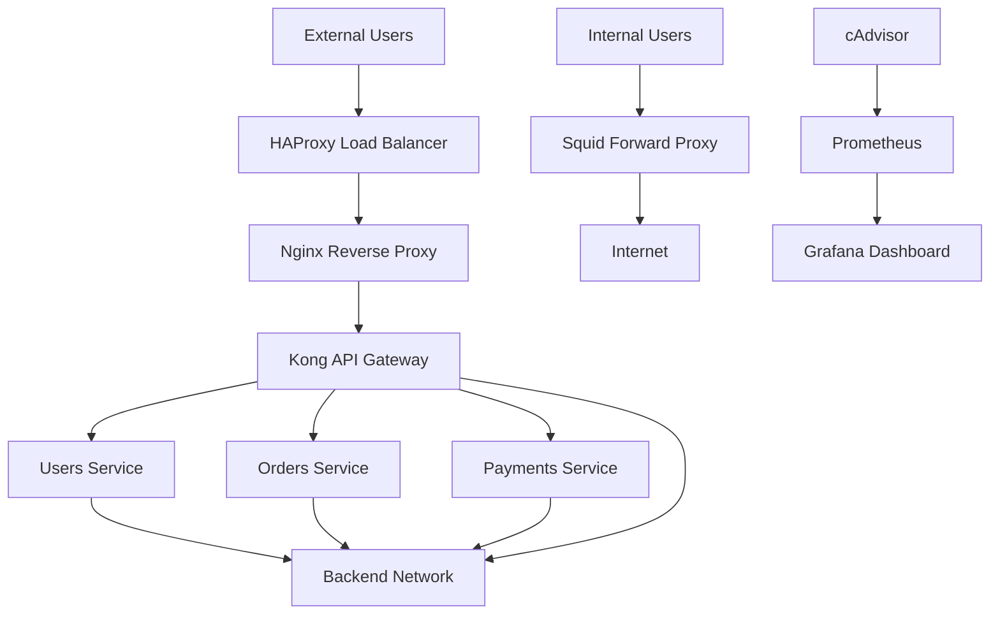

<<<<<<< HEAD
# Secure Multi-Layer Proxy Architecture

## Project Objective
Build a secure proxy architecture using Docker.

## Components
1. Squid Forward Proxy
2. HAProxy Load Balancer
3. Nginx Reverse Proxy
4. Kong API Gateway
5. User Service
6. Order Service
7. Payment Service

## Security Objectives
- Restrict direct internet access for internal users.
- Protect backend services.
- Implement network isolation.
- Enable logging at every layer.
- Test failure scenarios.

## Deployment
Docker Compose on Windows.
=======

# Secure Multi-Layer Proxy Architecture

A hands-on DevOps project demonstrating secure network segmentation, forward and reverse proxying, load balancing, API gateway routing, containerized microservices, failure recovery, and monitoring using Docker Compose.

## 1. Project Overview

This project implements a multi-layer proxy architecture using Docker containers.

It separates inbound application traffic from outbound internet traffic and protects backend microservices through Docker network segmentation.

It also includes a monitoring stack using cAdvisor, Prometheus, and Grafana to collect and visualize container resource metrics.

### Project Objectives

- Implement a Squid forward proxy for controlled outbound internet access.
- Configure HAProxy as an external load balancer.
- Configure Nginx as a reverse proxy.
- Use Kong as an API gateway.
- Deploy three independent Python microservices.
- Restrict direct access to backend services.
- Configure API rate limiting.
- Test service failures and recovery.
- Collect and visualize container CPU, memory, and network metrics.

## 2. Architecture



### Inbound traffic flow

1. External requests enter through HAProxy.
2. HAProxy forwards requests to Nginx.
3. Nginx forwards application requests to Kong.
4. Kong routes requests to the correct backend microservice.
5. The microservice returns a response through the proxy layers.

### Outbound traffic flow

1. Internal test clients connect to Squid.
2. Squid forwards permitted requests to the internet.
3. Direct internet access from the isolated internal-users network is restricted.

## 3. Technologies Used

| Technology | Purpose |
|---|---|
| Docker | Containerization |
| Docker Compose | Multi-container orchestration |
| Squid | Forward proxy |
| HAProxy | Load balancing |
| Nginx | Reverse proxy |
| Kong | API gateway and rate limiting |
| Python | Backend microservices |
| cAdvisor | Container metrics collection |
| Prometheus | Metrics collection and storage |
| Grafana | Monitoring dashboards |
| PowerShell | Windows command-line operations |

## 4. Project Structure

```text
Secure-multi-layer-proxy/
│
├── configs/
│   ├── squid/
│   │   └── squid.conf
│   ├── haproxy/
│   │   └── haproxy.cfg
│   ├── nginx/
│   │   └── default.conf
│   └── kong/
│       └── kong.yml
│
├── services/
│   ├── users/
│   │   ├── app.py
│   │   └── Dockerfile
│   ├── orders/
│   │   ├── app.py
│   │   └── Dockerfile
│   └── payments/
│       ├── app.py
│       └── Dockerfile
│
├── monitoring/
│   └── prometheus/
│       └── prometheus.yml
│
├── logs/
│   └── squid/
│
├── tests/
├── screenshots/
├── docs/
│
├── docker-compose.yml
├── README.md
└── .gitignore
```

## 5. Network Design

The project uses separate Docker bridge networks.

| Network | Subnet | Purpose |
|---|---|---|
| edge_net | 172.30.10.0/24 | External-facing HAProxy network |
| gateway_net | 172.30.20.0/24 | HAProxy, Nginx and Kong communication |
| internal_users_net | 172.30.30.0/24 | Isolated internal users |
| backend_net | 172.30.40.0/24 | Kong and backend microservices |
| proxy_egress | 172.30.50.0/24 | Squid internet connectivity |
| monitoring_net | Docker-assigned subnet | Monitoring services |

The gateway, internal-users, and backend networks are configured as internal networks.

Backend microservices are not published directly to host ports. Requests should enter through the configured proxy and gateway layers.

## 6. API Endpoints

The application is exposed locally through HAProxy on port 8080.

| Service | Endpoint |
|---|---|
| Users | `http://localhost:8080/api/users` |
| Orders | `http://localhost:8080/api/orders` |
| Payments | `http://localhost:8080/api/payments` |

Expected successful response: HTTP 200.

Kong is configured with a local rate limit of 10 requests per minute.

Requests exceeding the configured limit return HTTP 429.

## 7. Deployment Instructions

### Prerequisites

- Docker Desktop
- Docker Compose
- PowerShell
- Git
- A GitHub account

### Step 1: Clone the repository

```powershell
git clone <YOUR_GITHUB_REPOSITORY_URL>
cd Secure-multi-layer-proxy
```

### Step 2: Validate the Compose configuration

```powershell
docker compose config --quiet
```

### Step 3: Build and start the application

```powershell
docker compose up -d --build
```

### Step 4: Check container status

```powershell
docker compose ps
```

### Step 5: Test the APIs

```powershell
curl.exe -i http://localhost:8080/api/users
curl.exe -i http://localhost:8080/api/orders
curl.exe -i http://localhost:8080/api/payments
```

## 8. Security and Network Testing

The following tests were performed during implementation.

### Backend port exposure

```powershell
docker port users-service
docker port orders-service
docker port payments-service
```

No host port mappings were returned for the backend services.

### Direct backend access

```powershell
curl.exe --max-time 5 http://localhost:8000
```

Direct host access to the backend service port was unsuccessful, as expected.

### Network isolation

An attempted connection from the edge network to a backend service IP timed out.

### Kong rate limiting

Repeated API requests were used to test the configured rate limit.

HTTP 429 was observed after exceeding the configured request limit.

## 9. Failure and Recovery Testing

The following components were stopped and restarted to test recovery.

| Component | Failure test | Recovery |
|---|---|---|
| Users Service | API returned an error | HTTP 200 after restart |
| Kong | API returned HTTP 502 | HTTP 200 after restart |
| Nginx | HAProxy returned HTTP 503 | HTTP 200 after restart |
| HAProxy | Stopped and restarted | HTTP 200 after restart |

Example:

```powershell
docker stop users-service
curl.exe -i --max-time 10 http://localhost:8080/api/users
docker start users-service
curl.exe -i http://localhost:8080/api/users
```

## 10. Monitoring Implementation

The monitoring stack consists of three additional services.

### cAdvisor

Collects container metrics such as:

- CPU usage
- Memory usage
- Network traffic
- Container activity

### Prometheus

Scrapes cAdvisor metrics every 15 seconds.

Configuration file:

`monitoring/prometheus/prometheus.yml`

### Grafana

Displays monitoring information in a dashboard.

Local dashboard:

`http://localhost:3000`

Prometheus:

`http://localhost:9090`

cAdvisor:

`http://localhost:8081`

### Configured dashboard panels

1. Docker Container Memory Usage
2. Docker Container CPU Usage
3. Docker Container Network Received
4. Docker Container Network Transmitted

### Example Prometheus queries

Memory:

```promql
container_memory_usage_bytes
```

CPU:

```promql
rate(container_cpu_usage_seconds_total[5m]) * 100
```

Network received:

```promql
rate(container_network_receive_bytes_total[5m])
```

Network transmitted:

```promql
rate(container_network_transmit_bytes_total[5m])
```

## 11. Useful Docker Commands

Check running containers:

```powershell
docker ps
```

View logs:

```powershell
docker compose logs --tail 50
```

Follow logs:

```powershell
docker compose logs -f
```

Check resource usage:

```powershell
docker stats --no-stream
```

Stop project containers:

```powershell
docker compose stop
```

Start stopped containers:

```powershell
docker compose start
```

Remove project containers and networks without deleting named volumes:

```powershell
docker compose down
```

Do not use `docker compose down -v` unless you intentionally want to delete persistent monitoring data.

## 12. Project Results

The implementation demonstrated:

- Multi-layer proxy architecture.
- Forward and reverse proxy concepts.
- API gateway routing.
- Docker network segmentation.
- Restricted direct backend access.
- API rate limiting.
- Service failure and recovery testing.
- Container metrics collection.
- Grafana dashboard visualization.

## 13. Limitations and Future Improvements

This is a learning and demonstration environment, not a production-ready deployment.

Potential improvements include:

- Configure HTTPS and TLS certificates.
- Add authentication and authorization for APIs.
- Implement Grafana alert rules and notification channels.
- Add centralized log aggregation.
- Add health checks and automated recovery policies.
- Implement Kubernetes deployment.
- Add automated CI/CD using GitHub Actions.
- Improve service-level network isolation and security hardening.


>>>>>>> origin/main
