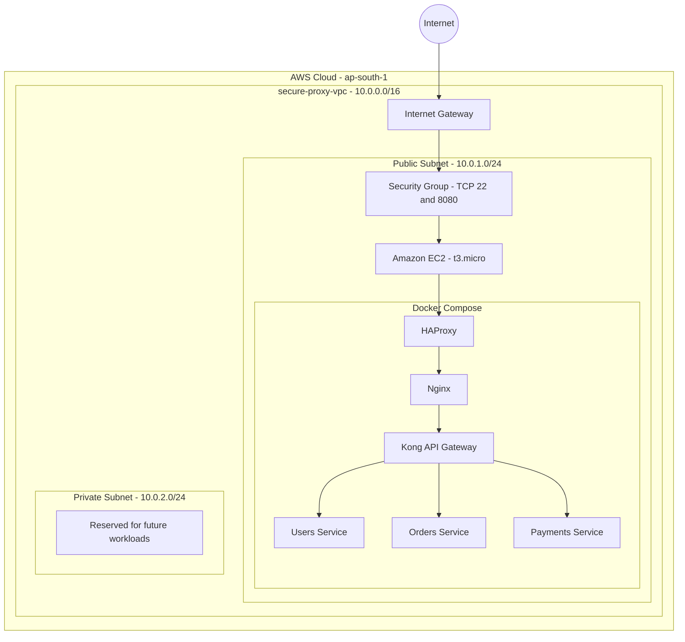

# AWS Architecture – Secure Multi-Layer Proxy

## 1. Architecture Overview

The project was deployed on Amazon EC2 within an AWS VPC.

The EC2 instance hosts Docker containers running the proxy, API gateway, and backend microservices.

## 2. AWS Infrastructure Diagram

## 3. Application Request Flow

1. An external client sends an HTTP request to the EC2 public IPv4 address on port 8080.
2. The EC2 security group permits traffic from the configured source IP.
3. HAProxy receives the request and forwards it to Nginx.
4. Nginx forwards the request to Kong API Gateway.
5. Kong routes the request to the appropriate backend microservice.
6. The backend service processes the request and returns a response through the proxy layers.

## 4. API Routing

| API Endpoint | Backend Service |
|---|---|
| `/api/users` | Users |
| `/api/orders` | Orders |
| `/api/payments` | Payments |

All three endpoints were tested successfully and returned HTTP 200.

## 5. Network Segmentation

The VPC contains two subnets:

- **Public subnet:** Hosts the EC2 instance running the application.
- **Private subnet:** Created for future workloads; no application containers were deployed there.

The private subnet does not have a default internet route. No NAT Gateway was created.

## 6. Important Architecture Notes

- The six deployed application services run on a single EC2 instance.
- Docker networking provides service-to-service communication within the host.
- The AWS private subnet is not equivalent to the internal Docker networks in the local Compose setup.
- Squid and the monitoring stack were not deployed on AWS.
- This architecture demonstrates the deployment and request flow, but it does not provide multi-instance high availability.

## 7. Future Improvements

- Move backend workloads to private EC2 instances or Amazon ECS/EKS.
- Introduce a managed Application Load Balancer.
- Configure monitoring with Amazon CloudWatch.
- Implement autoscaling and health checks.
- Add HTTPS using TLS certificates.
- Configure a NAT Gateway only if private workloads require outbound internet access.